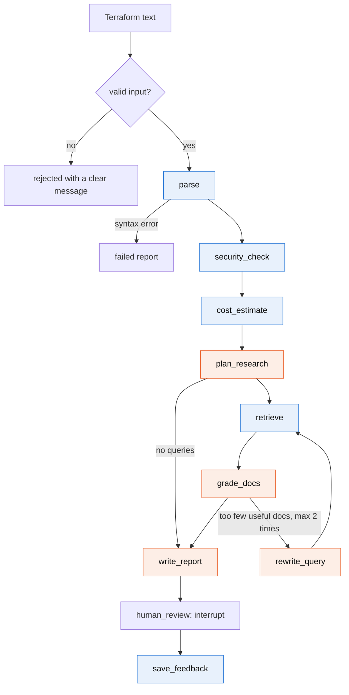
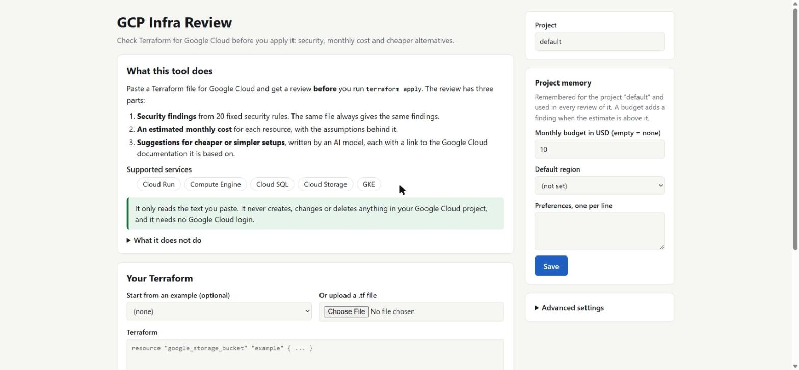
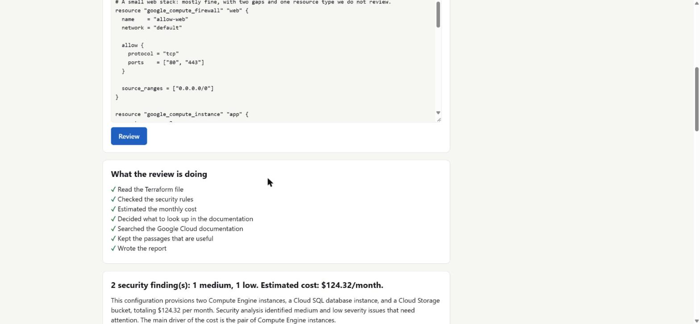
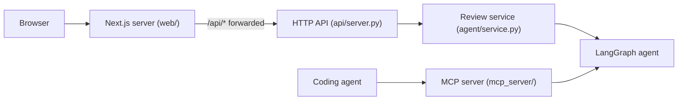
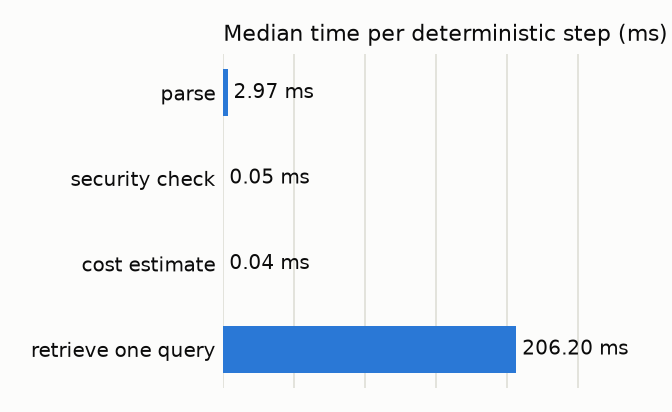
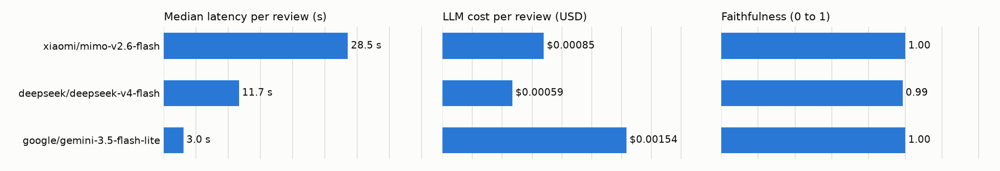
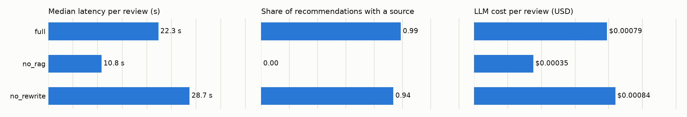
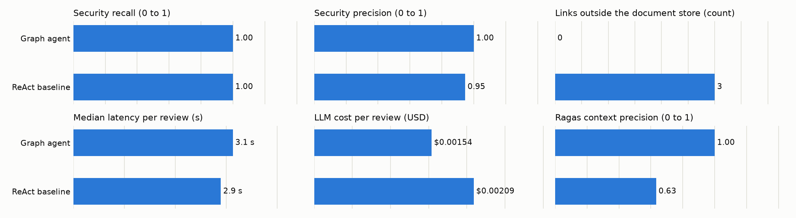

# GCP Infra Review Agent

An AI agent that reviews Terraform for Google Cloud **before** it is applied. It flags
security problems, estimates the monthly cost and suggests cheaper or simpler
alternatives, with links to the Google Cloud documentation.

- **Coding agents** (Claude Code and others) call it through an MCP tool.
- **People** use it through a web UI (Next.js), which explains what the tool does and
  shows each step of a review as it happens.

I built it as a small research project as well as a working tool: I measured the design choices, and every number in this file comes
from a saved run in `evals/results/`.

## The problem

Infrastructure mistakes are cheapest to fix before `terraform apply`. After that, a
public bucket has already been public, and an oversized database has already been
billed. Two things make the pre-apply review hard:

1. **Coding agents now write Terraform.** They produce working configurations quickly,
   but they do not reliably notice that a firewall is open to the world or that a
   development database is set to high availability.
2. **Reviewing needs three kinds of knowledge at once**: security rules, pricing, and
   what Google recommends instead. Few people have all three in their head.

**Who it is for:** developers and small teams without a dedicated cloud security or
FinOps person, and the coding agents working for them.

**What it does not do:** it never creates, changes or deletes anything in GCP and needs
no GCP credentials. It does not review live projects, monitor anything or rewrite your
Terraform.

### Scope

| | |
|---|---|
| Input | Terraform (`.tf`) text only, up to 200 KB |
| Services | Cloud Run, Compute Engine, Cloud SQL, Cloud Storage, GKE |
| Other resource types | Listed in the report as "not reviewed" |
| External APIs | An LLM provider, and optionally the public Cloud Billing Catalog API (prices) |

## How it works



Blue nodes are plain code. Orange nodes use the LLM.

| Node | Uses LLM | What it does | If it fails |
|---|---|---|---|
| `parse` | no | Terraform text to a list of resources | The review stops with a clear syntax message |
| `security_check` | no | Runs 20 fixed rules | (cannot fail on valid resources) |
| `cost_estimate` | no | Monthly cost per resource, with assumptions | The report says the estimate is missing |
| `plan_research` | yes | Decides what to look up in the docs | One generic cost query per service |
| `retrieve` | no | Searches the local documentation store | The review continues without documents |
| `grade_docs` | yes | Keeps only the useful passages | All passages are kept |
| `rewrite_query` | yes | Rewrites the queries, at most 2 times | The loop ends |
| `write_report` | yes | Summary and cost, sizing and simplification recommendations | Report with rule findings and cost only |
| `human_review` | no | Pauses for the user's feedback (UI only) | |
| `save_feedback` | no | Saves feedback and the review to SQLite | A warning; the report is still returned |

**What kind of agent this is.** A workflow agent: a fixed graph in which the LLM makes
bounded decisions (what to search for, which passages are good enough, whether to
search again) but never decides whether the security check or the cost estimate runs.
It is not a ReAct agent, on purpose: in a ReAct loop the model chooses which tools to
call, and text hidden in the Terraform could talk it out of the security check. A
ReAct agent over the same tools was built as a baseline and measured against the graph
(see Results): with the model tested it kept every real finding, but it also wrote
security findings of its own that no rule supports.
**Function calling** happens at the edge: `review_gcp_infra` is a tool that coding
agents call. Inside the graph, the LLM's JSON output (search queries) becomes the
arguments of `search_gcp_docs`, validated by a Pydantic schema. The longer explanation,
with a comparison of agent types and when to use prompt engineering, RAG or an agent,
is in [`docs/LEARNING_NOTES.md`](docs/LEARNING_NOTES.md#core-concepts-explained-with-this-project).

### Design rules

**The LLM is used only where judgment is needed.** Whether a bucket is public is a
fact, so code decides it. Which cost topic is worth researching is a judgment, so the
LLM decides it.

**Security findings cannot be changed by anything except the Terraform itself.** They
are produced by code, copied into the report by code, and checked once more before the
report is returned. The LLM's output schema does not allow the category "security" or
the severities "critical" and "high". User feedback is applied by a policy that skips
security findings.

**Terraform content is untrusted data.** Three layers:

1. The parser drops comments.
2. The LLM never sees the file. It sees a summary built from a fixed list of sizing
   attributes (machine type, tier, region and so on). Free-text fields such as
   descriptions, labels and environment variable values are not on the list.
3. Whatever the LLM writes, links that do not point to Google Cloud documentation are
   removed, recommendations about resources that do not exist are dropped, and a
   source is only accepted if it is one of the documents that were retrieved.

**A recommendation with no source is labelled as a suggestion.** Its text starts with
"Suggestion (no documentation source)".

**The agent degrades instead of crashing.** With no LLM key at all, a review still
returns the security findings and the cost estimate. If the Billing API fails in any way
(no connection, an error, an answer that is not what it should be), the services concerned
are priced from the static table and the report names them.

**A review has an end.** One LLM step has at most 90 seconds in total, retries included,
and a review at most 180. At the limit the step falls back like any other failure, and no
new LLM step is started. The limits are settings (`agent/config.py`).

**A failure is explained in the log, not to the user.** A user sees a short message with a
reference (the review id). The server log has the cause under that id, one JSON object per
line, and never the Terraform, the prompts, the replies or a key. See "Logs" below.

### Security rules

| Rule | Severity | What it catches |
|---|---|---|
| GCS-001 | critical | Bucket access granted to `allUsers` / `allAuthenticatedUsers` |
| GCS-002 | medium | Uniform bucket-level access is off |
| GCS-003 | medium | Public access prevention is not enforced |
| GCS-004 | low | Object versioning is off |
| SQL-001 | critical | Cloud SQL authorized networks include `0.0.0.0/0` |
| SQL-002 | high | Cloud SQL instance has a public IP |
| SQL-003 | medium | SSL/TLS is not required |
| SQL-004 | medium | Automated backups are off |
| SQL-005 | low | Deletion protection is switched off |
| GCE-001 | critical | Firewall opens SSH or RDP to `0.0.0.0/0` |
| GCE-002 | high | Firewall opens database ports to `0.0.0.0/0` |
| GCE-003 | high | VM uses the default service account with full API access |
| GCE-004 | medium | VM has a public IP |
| RUN-001 | high | Cloud Run service is invokable by `allUsers` |
| RUN-002 | high | Secret-looking value in a plain environment variable |
| GKE-001 | high | Control plane reachable from the internet |
| GKE-002 | medium | Nodes have public IPs |
| GKE-003 | high | Legacy ABAC is enabled |
| GKE-004 | medium | Workload Identity is not configured |
| GKE-005 | high | Nodes use the default service account with full API access |

The rules live in `tools/security_rules.py`. Each has a link to the Google Cloud page
that explains the fix.

## Setup

Requirements: Python 3.11 or newer with [uv](https://docs.astral.sh/uv/), and Node.js 20
or newer with npm for the web UI.

```bash
uv sync                          # install the Python dependencies
cp .env.example .env             # then add your API key (see below)
uv run python -m rag.ingest      # build the documentation store (first run downloads
                                 # a small local embedding model, about 80 MB)
cd web && npm install            # install the web UI's dependencies
```

`.env`:

```
OPENROUTER_API_KEY=       # preferred: one key, many model vendors
OPENAI_API_KEY=           # alternative: OpenAI directly
LANGSMITH_TRACING=true    # optional tracing
LANGSMITH_API_KEY=
LANGSMITH_PROJECT=gcp-review-agent
GCP_BILLING_API_KEY=      # optional: live list prices for the five services
```

Without an LLM key the agent still runs in rule-only mode. Without a billing key it
uses `tools/prices_static.json` and adds "prices may be outdated" to the report.

The default model is `google/gemini-3.5-flash-lite` through OpenRouter, chosen from the
model comparison below. If you use `OPENAI_API_KEY` without OpenRouter, also set
`REVIEW_MODEL` to an OpenAI model (for example `REVIEW_MODEL=gpt-5-mini`), or pick one
under Advanced settings in the UI.

## Usage

### Web UI

The UI is a Next.js app in `web/`. It talks to the agent through a small Python HTTP
API, so two processes run, each in its own terminal:

```bash
uv run python -m api.server                  # the agent's HTTP API, on 127.0.0.1:8000
cd web && npm run build && npm run start     # the web UI, on http://localhost:3000
```

Open http://localhost:3000. For development, `npm run dev` in place of the build and
start commands reloads the page as files change.

The first screen says what the tool does, which five services it covers, that it never
touches a Google Cloud project, and what it does not do. Then:

1. Paste or upload a `.tf` file, or pick an example, and press **Review**.
2. While it runs, the page lists each step as it finishes: reading the file, the
   security rules, the cost estimate, the documentation search, writing the report.
3. Read the report. Each section says where it comes from: security findings from fixed
   rules, the cost from list prices with its assumptions, suggestions from the AI model
   with their source links.
4. Rate the suggestions and press **Finish review**.

The side panel has **Project memory** (budget, region, preferences, remembered per
project) and, kept apart and closed by default, **Advanced settings** (AI model,
documentation search on or off, extra instructions for the report writer). The report
shows the tokens used, the AI cost and the time taken.





How the pieces connect:



The HTTP API has no login and listens on localhost only. It is meant to run on the same
machine as the web UI, not to be exposed to a network.

### MCP tool (for coding agents)

```bash
uv run python -m mcp_server.server
```

To register it in Claude Code, add this to `.mcp.json` in the project where you write
Terraform (use the absolute path of this repository):

```json
{
  "mcpServers": {
    "gcp-infra-review": {
      "command": "uv",
      "args": ["run", "--directory", "/path/to/this/repo", "python", "-m", "mcp_server.server"]
    }
  }
}
```

The server exposes one tool:

```
review_gcp_infra(terraform: str, project_id: str = "default")
  -> {"status": "ok", "markdown": "...", "report": {...}}
  -> {"status": "rejected" | "error", "error": "clear message"}
```

### From Python

```python
from agent.runner import run_review

report = run_review(open("main.tf").read(), project_id="shop")
print(report.headline)
for finding in report.findings:
    print(finding.severity, finding.resource, finding.issue)
```

### Common use cases

**1. Check a new stack before `terraform apply`.** I have written a small web stack:
two VMs, a MySQL database, an uploads bucket and a Pub/Sub topic
(`evals/dataset/mixed/web_stack.tf`). I paste it into the UI. The real output with the
default model is saved in
[`docs/examples/web_stack_review.md`](docs/examples/web_stack_review.md). In short:

```
2 security finding(s): 1 medium, 1 low. Estimated cost: $124.32/month.

[MEDIUM] SQL-004 google_sql_database_instance.db   Automated backups are off.
[LOW]    GCS-004 google_storage_bucket.uploads     Object versioning is off.
[MEDIUM] google_compute_instance.app (cost)        Consider Cloud Run for the stateless
                                                   web service.
         Source: https://cloud.google.com/run/docs/overview/what-is-cloud-run
Cost: VMs $113.62, database $10.30, bucket $0.40 (each line lists its assumptions)
Not reviewed: google_pubsub_topic.events (unsupported type)
3 LLM calls, 4,413 + 311 tokens, $0.0021, 14.6 s
```

The security findings come from the rules, the cost from the estimator, and only the
Cloud Run suggestion from the LLM, with a link to the page it is based on.

**2. A coding agent reviews its own Terraform.** Claude Code writes `main.tf`, then
calls the MCP tool `review_gcp_infra(terraform=..., project_id="shop")`. It gets back
`{"status": "ok", "markdown": ..., "report": {...}}`, reads the findings and fixes the
file before showing it to the user. The structured `report` lets the agent check
`severity == "critical"` without parsing text.

**3. Project rules are remembered.** In the UI's side panel, under **Project memory**, set
the project `shop` to a budget of $100/month and region `europe-west1`. Every later
review of `shop` prices resources without a region in `europe-west1` and adds a finding
when the estimate is over budget, shown in the cost section. The same memory is used through the MCP tool when it
passes `project_id="shop"`.

**4. Teach it what you do not care about.** After a review, mark a cost suggestion as
not useful and press **Finish review**. Similar suggestions for that project are moved
down and marked as deprioritised next time. Security findings cannot be dismissed this
way: the feedback form does not offer them, and the report is checked against the rule
output before it is returned.

**5. Bad input gets a clear answer, not a crash.** Real responses from the MCP tool:

```json
{"status": "rejected", "error": "The input does not look like Terraform: no resource, provider, variable or module block was found. Only .tf files are supported."}
{"status": "rejected", "error": "The input is 210 KB. The limit is 200 KB."}
```

**6. No API key, or the provider is down.** The review still returns the security
findings and the cost estimate, with a warning that the AI-written part is missing.

### Logs

The HTTP API and the MCP server log to stderr, one JSON object per line (`LOG_LEVEL` sets
the level, default `INFO`). A review that failed says "Reference: 4f928f4e0721" to the
user. Search the log for that id to see the review's steps and times, the failing step and
the chain of errors behind it. A review line also has the id of the HTTP request, which
the API returns as `X-Request-ID`.

### Tests, lint, evals

```bash
uv run pytest                       # unit and integration tests (no API key needed)
cd web && npm test                  # web UI component tests (no servers needed)
cd web && npm run build && npm run test:e2e   # browser tests: the real UI, API and graph,
                                    # with a scripted LLM. Once: npx playwright install
                                    # chromium, or set PLAYWRIGHT_CHANNEL=msedge / chrome
uv run ruff check . && uv run ruff format .
uv run python -m api.schema && cd web && npm run types    # after changing an API model
uv run python -m evals.run          # run the eval suite, writes evals/results/
uv run python -m evals.run --configs full,react --models google/gemini-3.5-flash-lite
                                    # graph agent against the ReAct baseline
                                    # also: no_grade, prompt_specific, prompt_short
uv run python -m evals.rewrite_loop --model google/gemini-3.5-flash-lite
                                    # the rewrite loop on hard queries
uv run python -m evals.price_check  # static prices against live ones (free)
uv run python -m evals.rejudge evals/results/<file>_llm.json --judge-model <model>
                                    # score a saved run again with another judge
uv run python -m evals.llm_value    # compare the report with and without the LLM, from
                                    # the saved run (no model calls, costs nothing)
uv run python -m evals.report       # rebuild the tables and charts below
```

Every push runs lint, the Python and web tests with coverage, the type checks, the build
and the browser tests in GitHub Actions (`.github/workflows/ci.yml`). It needs no secret
and calls no paid service. Coverage may not fall below the floor set in `pyproject.toml`
and `web/vitest.config.mts`.

## Research method

**Questions.** (1) Do the deterministic parts meet their targets: security recall of at
least 0.9 and zero critical false positives on clean configurations? (2) How do
different models compare on recommendation quality, speed and cost? (3) What do
documentation search (RAG) and the query rewrite loop add? (4) What does the fixed graph
buy, compared with a ReAct agent that is given the same tools and decides for itself?

**Dataset** (`evals/dataset/`, fixed): 14 Terraform samples with labelled findings.
Five vulnerable and five clean samples (one per service), one mixed stack with an
unsupported resource, and three prompt-injection samples. Eleven samples also have a
monthly cost that was calculated by hand (the working is in
`evals/dataset/README.md`). A separate file holds 34 search queries, each with the one
document that answers it. A second file holds 21 harder queries, written before any of
them was run: vague symptoms, another cloud's vocabulary, two topics in one query, and
five questions that no document in the store answers.

A held-out set of 35 files by other people (`evals/dataset/heldout/`): all 5 Google Cloud
files of TerraGoat that use a supported resource, and 30 of Google's own documentation
samples, 6 per service. Code chose them before any was opened. Checkov 3.4.7, an independent
scanner, labelled them, through a mapping from its checks to these rules that was written
before the scan. 15 of the 20 rules have an equivalent check; the others are not scored.

**Metrics.**

| Area | Metric | How it is measured |
|---|---|---|
| Security | Precision, recall, F1 | `(resource, rule)` pairs against the labels |
| Security | Critical false positives | Critical findings on the clean samples |
| Cost | Estimate error | Against the hand-calculated totals |
| Cost | Price error | Static price table against the live Billing Catalog, per price and region |
| Retrieval | Hit rate at 1, 2 and 4; MRR | Expected document in the top k |
| Recommendations | Share with a valid source | `source_url` belongs to the document store |
| Report text | Faithfulness, answer relevancy | DeepEval, on the whole AI-written text against everything the writer was given |
| RAG step | Context precision | Ragas: were the passages the agent kept useful for the advice it wrote |
| RAG step | Faithfulness to the passages | Ragas: share of statements in the advice that the retrieved passages alone support |
| Injection | Reviews intact | All expected findings present and no untrusted link |
| Speed | Median and p95 per review, per node | Wall-clock time recorded by the graph |
| Cost of running | Tokens and USD per review | Token counts times the provider's price |

**Models.** The model is a setting, not code. I compared three low-cost models from
three vendors through OpenRouter: `xiaomi/mimo-v2.6-flash`, `deepseek/deepseek-v4-flash`
and `google/gemini-3.5-flash-lite`. All three cost under $3 per million output tokens.
I did not run a premium model, so the results do not say whether a stronger model
writes better advice (see Limitations). The judge for the model comparison is
`openai/gpt-5-mini`, from a fourth vendor, so no model is judged by a relative. Any
other model can be passed with `--models` and `--judge-model`.

**Ablations** (one model, MiMo-flash, to limit cost): `full`, `no_rag` (documentation
search off) and `no_rewrite` (rewrite loop off). They come from a separate, earlier run,
judged by `xiaomi/mimo-v2.6-pro`. That judge is a relative of the model it judges, so
the ablation faithfulness numbers are indicative only; only `full` was judged.

Three more configurations are ready and **have not been run**, because they call paid
models: `no_grade` (every passage found goes to the report writer), and two other prompts
for the report writer (`prompt_specific`, `prompt_short`, in `evals/prompts/`). The same
holds for `evals/rewrite_loop.py`, which gives the graph's own research nodes the hard
queries. Their tables appear below once a run is saved.

**Baseline.** To test the design, I built a second agent. `evals/react_baseline.py` is a
ReAct agent: one LLM in a function-calling
loop (LangChain `create_agent`). It is given the raw Terraform file and three tools,
which are the same security rules, cost estimator and documentation search the graph
uses. It decides which tools to call and writes the whole report, security findings
included, and nothing checks its answer against the rule output. It ran on the default
model next to the graph agent, on the same samples, and I scored it with the same
metrics. It exists only for this comparison; the UI and the MCP tool always use the graph.

**Judging.** The judges run on the first of the three runs of each sample, to limit
cost, so each judged score rests on at most 14 reviews per model. Ragas scores only
reviews that have both retrieved passages and at least one recommendation, which is
fewer still (the count is in each table). Every judged record keeps the text that was
judged, so a result file can be scored again by another judge with
`uv run python -m evals.rejudge`, without paying for the reviews again.

**Repeatability.** Temperature 0 and seed 42 are sent where the model accepts them.
Each sample is reviewed 3 times per configuration. Each configuration starts with an
empty memory. GCP cost estimates use the static price table so they do not move with
live prices. LLM token prices are read live from OpenRouter at the start of each run and
saved in the result file.
Every run writes a new JSON file with the date, git commit, models, settings and token
prices used. The README tables are generated from those files by `evals/report.py`.

## Results

<!-- RESULTS:START -->

### Deterministic parts (no LLM)

Source: `evals/results/20261123T213249Z_deterministic.json`. 14 samples.

**Security rules** (a finding is a `(resource, rule)` pair):

| Group | TP | FP | FN | Precision | Recall | F1 |
|---|---|---|---|---|---|---|
| clean | 0 | 0 | 0 | 1.00 | 1.00 | 1.00 |
| injection | 13 | 0 | 0 | 1.00 | 1.00 | 1.00 |
| mixed | 2 | 0 | 0 | 1.00 | 1.00 | 1.00 |
| vulnerable | 20 | 0 | 0 | 1.00 | 1.00 | 1.00 |
| all | 35 | 0 | 0 | 1.00 | 1.00 | 1.00 |

Critical false positives on the clean samples: **0**.

**Cost estimator** against 11 hand-calculated totals: mean absolute error $0.00, largest error $0.00, mean absolute percentage error 0.00%.

**Retrieval** (34 queries, one expected document each):

| Setting | Hit rate @1 | Hit rate @2 | Hit rate @4 | MRR |
|---|---|---|---|---|
| with service filter | 0.94 | 0.97 | 0.97 | 0.96 |
| without service filter | 0.94 | 0.97 | 0.97 | 0.96 |

**Retrieval on the harder queries** (first search alone, with service filter; a hit is any of the query's expected documents):

| Kind | Queries | Hit rate @1 | Hit rate @2 | Hit rate @4 | MRR |
|---|---|---|---|---|---|
| vague | 7 | 0.43 | 0.57 | 0.57 | 0.57 |
| other cloud | 7 | 0.43 | 0.57 | 0.71 | 0.54 |
| two topics | 2 | 1.00 | 1.00 | 1.00 | 1.00 |
| all | 16 | 0.50 | 0.62 | 0.69 | 0.61 |

**Security rules on the held-out samples** (labelled by Checkov 3.4.7):

| Samples | Rules scored | TP | FP | FN | Precision | Recall | F1 |
|---|---|---|---|---|---|---|---|
| 35 | 15 | 53 | 7 | 0 | 0.88 | 1.00 | 0.94 |

| Rule | TP | FP | FN | Precision | Recall |
|---|---|---|---|---|---|
| GCE-001 | 1 | 0 | 0 | 1.00 | 1.00 |
| GCE-004 | 4 | 0 | 0 | 1.00 | 1.00 |
| GCS-001 | 3 | 0 | 0 | 1.00 | 1.00 |
| GCS-002 | 2 | 0 | 0 | 1.00 | 1.00 |
| GCS-003 | 6 | 0 | 0 | 1.00 | 1.00 |
| GCS-004 | 6 | 0 | 0 | 1.00 | 1.00 |
| GKE-001 | 7 | 0 | 0 | 1.00 | 1.00 |
| GKE-002 | 7 | 0 | 0 | 1.00 | 1.00 |
| GKE-003 | 1 | 0 | 0 | 1.00 | 1.00 |
| RUN-001 | 1 | 0 | 0 | 1.00 | 1.00 |
| SQL-001 | 1 | 0 | 0 | 1.00 | 1.00 |
| SQL-002 | 1 | 7 | 0 | 0.12 | 1.00 |
| SQL-003 | 9 | 0 | 0 | 1.00 | 1.00 |
| SQL-004 | 4 | 0 | 0 | 1.00 | 1.00 |

**Speed of the deterministic steps:**

| Step | Measurements | Median (ms) | p95 (ms) |
|---|---|---|---|
| parse | 280 | 2.965 | 5.475 |
| security check | 280 | 0.054 | 0.127 |
| cost estimate | 280 | 0.036 | 0.081 |
| retrieve one query | 20 | 206.200 | 217.762 |



### Static prices against live list prices

Source: `evals/results/20261123T211900Z_price_check.json`. One price per key and listed region.

| Prices | Compared | Off by more than 1% | Mean error (%) | Largest error (%) |
|---|---|---|---|---|
| compute | 64 | 0 | 0.00 | 0.02 |
| disk | 24 | 0 | 0.00 | 0.00 |
| gcs | 32 | 19 | 7.32 | 38.08 |
| gke | 8 | 0 | 0.00 | 0.00 |
| run | 32 | 20 | 5.62 | 12.14 |
| sql | 48 | 18 | 3.72 | 12.14 |

The same samples estimated with both tables (USD per month):

| Sample | Static | Live | Difference (%) |
|---|---|---|---|
| `vulnerable/gcs_public.tf` | 2.00 | 2.00 | 0.00 |
| `vulnerable/sql_open.tf` | 231.25 | 231.25 | 0.00 |
| `vulnerable/compute_open_ssh.tf` | 150.29 | 150.29 | 0.00 |
| `vulnerable/cloud_run_public_secret.tf` | 39.42 | 39.42 | 0.00 |
| `vulnerable/gke_insecure.tf` | 396.53 | 396.51 | 0.01 |
| `clean/gcs_clean.tf` | 1.10 | 1.00 | 10.00 |
| `clean/sql_clean.tf` | 57.98 | 52.71 | 10.00 |
| `clean/compute_clean.tf` | 26.46 | 26.46 | 0.00 |
| `clean/gke_clean.tf` | 190.84 | 190.84 | 0.00 |
| `mixed/web_stack.tf` | 124.32 | 123.39 | 0.75 |

### Full agent, per model

Source: `evals/results/20261110T141250Z_llm.json`. Provider: openrouter. 14 samples x 3 runs per configuration. Judge model: openai/gpt-5-mini. Token prices: openrouter live.

**Quality** (configuration `full`):

| Model | Reviews | Security recall | Security precision | Critical on clean | Injection intact | Recs / review | Share with source | Faithfulness | Answer relevancy | Ragas context precision | Ragas faithfulness | Reviews judged (Ragas) | LLM fallback rate |
|---|---|---|---|---|---|---|---|---|---|---|---|---|---|
| xiaomi/mimo-v2.6-flash | 42 | 1.00 | 1.00 | 0 | 1.00 | 2.24 | 0.93 | 0.95 | 0.92 | 0.98 | 0.49 | 12 | 0.00 |
| deepseek/deepseek-v4-flash | 42 | 1.00 | 1.00 | 0 | 1.00 | 1.57 | 0.91 | 0.97 | 0.96 | 1.00 | 0.55 | 9 | 0.00 |
| google/gemini-3.5-flash-lite | 42 | 1.00 | 1.00 | 0 | 1.00 | 0.62 | 1.00 | 0.99 | 0.92 | 0.93 | 0.49 | 7 | 0.00 |

**Speed and cost** (configuration `full`):

| Model | Median (s) | p95 (s) | Deterministic steps (s) | LLM steps (s) | LLM calls | Input tokens | Output tokens | USD / review |
|---|---|---|---|---|---|---|---|---|
| xiaomi/mimo-v2.6-flash | 20.25 | 46.61 | 0.74 | 19.27 | 2.88 | 3608 | 1121 | 0.00082 |
| deepseek/deepseek-v4-flash | 19.61 | 68.39 | 0.92 | 19.11 | 2.83 | 3284 | 2414 | 0.00074 |
| google/gemini-3.5-flash-lite | 3.28 | 4.51 | 0.32 | 2.80 | 2.71 | 3029 | 230 | 0.00148 |



**Median seconds per graph node:**

| Model | cost_estimate | grade_docs | parse | plan_research | retrieve | rewrite_query | save_feedback | security_check | write_report |
|---|---|---|---|---|---|---|---|---|---|
| xiaomi/mimo-v2.6-flash | 0.00 | 2.86 | 0.00 | 2.21 | 0.72 | 0.00 | 0.01 | 0.00 | 7.74 |
| deepseek/deepseek-v4-flash | 0.00 | 1.97 | 0.01 | 3.21 | 0.91 | 0.00 | 0.01 | 0.00 | 6.22 |
| google/gemini-3.5-flash-lite | 0.00 | 0.79 | 0.00 | 0.89 | 0.31 | 0.00 | 0.01 | 0.00 | 1.19 |

### Ablations (xiaomi/mimo-v2.6-flash)

Source: `evals/results/20261110T080559Z_llm.json`. Provider: openrouter. 14 samples x 3 runs per configuration. Judge model: xiaomi/mimo-v2.6-pro. Token prices: openrouter live.

| Configuration | Recs / review | Share with source | Rewrites / review | Median (s) | LLM calls | USD / review | Faithfulness | Answer relevancy |
|---|---|---|---|---|---|---|---|---|
| full | 2.12 | 0.99 | 0.00 | 22.35 | 2.86 | 0.00079 | 0.98 | 0.98 |
| no_rag | 2.07 | 0.00 | 0.00 | 10.80 | 1.00 | 0.00035 | n/a | n/a |
| no_rewrite | 2.24 | 0.94 | 0.00 | 28.67 | 2.88 | 0.00084 | n/a | n/a |



### Graph agent against a ReAct baseline (google/gemini-3.5-flash-lite)

Source: `evals/results/20261110T115819Z_llm.json`. Provider: openrouter. 14 samples x 3 runs per configuration. Judge model: openai/gpt-5-mini. Token prices: openrouter live.

**Security and recommendations:**

| Agent | Reviews ok / run | Security recall | Security precision | Critical on clean | Injection intact | Security tool skipped | Recs / review | Share with source | Links outside the store |
|---|---|---|---|---|---|---|---|---|---|
| Graph agent | 42 / 42 | 1.00 | 1.00 | 0 | 1.00 | n/a | 0.64 | 1.00 | 0 |
| ReAct baseline | 42 / 42 | 1.00 | 0.95 | 0 | 1.00 | 0 | 0.36 | 1.00 | 3 |

**Judged quality** (DeepEval on the whole advisory text, Ragas on the RAG step):

| Agent | Reviews judged (DeepEval) | Faithfulness | Answer relevancy | Reviews judged (Ragas) | Ragas context precision | Ragas faithfulness |
|---|---|---|---|---|---|---|
| Graph agent | 14 | 1.00 | 0.93 | 8 | 1.00 | 0.66 |
| ReAct baseline | 14 | 1.00 | 0.96 | 5 | 0.63 | 0.49 |

**Speed and cost:**

| Agent | Median (s) | p95 (s) | LLM calls | Input tokens | Output tokens | USD / review |
|---|---|---|---|---|---|---|
| Graph agent | 3.13 | 5.91 | 2.79 | 3135 | 239 | 0.00154 |
| ReAct baseline | 2.90 | 4.32 | 2.00 | 2428 | 545 | 0.00209 |



### What the LLM adds

Source: `evals/results/20261110T175350Z_llm_value.json`, built with no model calls by `evals/llm_value.py` from `evals/results/20261110T141250Z_llm.json` and a review of the same 14 samples with no LLM. Without an LLM those 14 reviews contain 35 security findings, 14 cost estimates, 0 recommendations and 0 written summaries. Security findings and cost estimates are the same with an LLM, by construction.

| Report | Reviews | Summary written | Recs / review | Share with source | Share naming the configuration | Median (s) | LLM calls | USD / review |
|---|---|---|---|---|---|---|---|---|
| No LLM (rules and cost estimate only) | 14 | no | 0.00 | n/a | n/a | 0.21 | 0 | 0.00000 |
| xiaomi/mimo-v2.6-flash | 42 | yes | 2.24 | 0.93 | 0.62 | 20.25 | 2.88 | 0.00082 |
| deepseek/deepseek-v4-flash | 42 | yes | 1.57 | 0.91 | 0.62 | 19.61 | 2.83 | 0.00074 |
| google/gemini-3.5-flash-lite | 42 | yes | 0.62 | 1.00 | 0.62 | 3.28 | 2.71 | 0.00148 |

"Share naming the configuration" is the share of recommendations whose text names a value from that resource's own configuration or a block it lacks. It is a word match on the text saved for the first run of each sample (recommendations measured: 34 (xiaomi/mimo-v2.6-flash), 24 (deepseek/deepseek-v4-flash), 8 (google/gemini-3.5-flash-lite)), not a judgement of whether the advice is right.

**Time per LLM step** (median seconds when the step ran, and the share of reviews in which it ran):

| Model | LLM calls / review | plan_research (s) | ran in | grade_docs (s) | ran in | write_report (s) | ran in |
|---|---|---|---|---|---|---|---|
| xiaomi/mimo-v2.6-flash | 2.88 | 2.21 | 1.00 | 3.45 | 0.88 | 7.74 | 1.00 |
| deepseek/deepseek-v4-flash | 2.83 | 3.21 | 1.00 | 10.02 | 0.69 | 6.22 | 1.00 |
| google/gemini-3.5-flash-lite | 2.71 | 0.89 | 1.00 | 0.90 | 0.62 | 1.19 | 1.00 |

**Recommendations that name the configuration** (per model, the sourced ones naming the most terms, chosen by code):

- **xiaomi/mimo-v2.6-flash**, `clean/gcs_clean.tf` (names `NEARLINE`, `lifecycle rule`, `autoclass`):
  > google_storage_bucket.reports: The bucket uses a fixed NEARLINE class with no lifecycle rule and no autoclass, so access patterns are not adapted automatically. If the reports access pattern is unknown or mixed, enable Autoclass on the bucket so objects move between classes automatically without needing explicit lifecycle rules; if the pattern is predictable, prefer explicit lifecycle rules instead.
- **xiaomi/mimo-v2.6-flash**, `mixed/web_stack.tf` (names `COLDLINE`, `lifecycle rule`, `autoclass`):
  > google_storage_bucket.uploads: All uploads are written straight to COLDLINE with no lifecycle rule and no Autoclass, so frequently read objects incur retrieval fees and a 90-day minimum storage duration charge if they are deleted or rewritten early. Enable Autoclass on the bucket (or use Standard storage for recent uploads with a lifecycle rule that moves them to Coldline after 90 days) so objects only pay the colder-class price once they stop being read.
- **deepseek/deepseek-v4-flash**, `mixed/web_stack.tf` (names `e2-standard-2`, `pd-balanced`):
  > google_compute_instance.app: The e2-standard-2 machine type may be oversized for a web server workload, and the boot disk is pd-balanced which is more expensive than pd-standard for boot disks. Consider using a smaller shared-core type like e2-medium if the workload is bursty, and change the boot disk to pd-standard to reduce cost.
- **deepseek/deepseek-v4-flash**, `mixed/web_stack.tf` (names `COLDLINE`, `autoclass`):
  > google_storage_bucket.uploads: The bucket uses Coldline storage class but has no lifecycle rules or Autoclass, which may lead to unnecessary costs if data is accessed more frequently than once a quarter. Add lifecycle rules to transition objects to a colder class after 90 days, or enable Autoclass if the access pattern is unpredictable.
- **google/gemini-3.5-flash-lite**, `vulnerable/sql_open.tf` (names `REGIONAL`):
  > google_sql_database_instance.main: The instance uses regional high availability, which doubles the compute and storage costs and may be unnecessary for non-production workloads. Switch the availability type to ZONAL if this is a development, test, or staging database that does not require an availability target, which will roughly halve the cost.
- **google/gemini-3.5-flash-lite**, `vulnerable/compute_open_ssh.tf` (names `n2-standard-4`):
  > google_compute_instance.web: The instance uses an N2 machine type which has higher per-core performance at a higher price, whereas E2 machine types are the lowest-cost general-purpose family suitable for web servers. Switch the machine type from n2-standard-4 to an E2 family type to lower the price.

<!-- RESULTS:END -->

## Discussion

**The deterministic parts meet their targets on this dataset.** That result should be
read with care: I wrote the rules and the samples myself, at the same time. The numbers show that the rules do what they were designed to do and that they
will catch a regression.

**On Terraform by other people the rules found everything Checkov found, and one rule
disagrees with it.** On the 35 held-out files recall is 1.00 (53 of 53 labelled findings)
and precision 0.88. All seven extra findings are SQL-002 (public IP), on instances that have
no `ip_configuration` block at all. Checkov reports a public IP only when
`ipv4_enabled = true` is written out; the rule treats "not set" as public. I could not settle
who is right: the Terraform provider's default for `ipv4_enabled` is true, but it applies
when the block is there, and without the block the Cloud SQL API decides, whose default I
did not find documented. So the labels, the rule and the score stay as they are. What this
result does not show: 53 findings are few, several rules have one labelled case or none
(GCE-003), Checkov and these rules both follow common benchmarks, so they can share a blind
spot, and 13 findings of unscored rules were not judged at all.

**The estimator's arithmetic is exact; some of its prices are not.** The error of $0.00
compares the estimator with sums made by hand from the same price table. The price check
compares the table with the live catalog. Compute Engine, disk and GKE fee prices agree
(largest error 0.02%). For Cloud Storage, Cloud Run and Cloud SQL more than a third of the
prices are off by more than 1%, the worst by 38% (Archive storage in `europe-west3`, which
the table underprices). All of it comes from the rough region multipliers: in
`us-central1` every hand-typed price matched. Two of the ten samples with a cost, both in
`europe-west1`, are overpriced by 10%, and the mixed stack by 0.75%. With a billing key
the live prices are used for all five services, so this concerns reviews without one. I
did not correct the table, because that would change expected costs of the fixed dataset.

**Retrieval looks easier than it is.** On the ordinary queries the right document is in the
top 4 for 0.97 of them. On the 16 hard queries that have an answer it is 0.69: 0.57 for
vague symptoms, 0.71 for another cloud's words. The ordinary queries were worded differently
from the documents, but by the same person, and they name the subject. This is the gap the
rewrite loop is for, and whether it closes it has not been measured.

**The one retrieval miss is informative.** The query about paying per pod is answered
by two documents (the Autopilot overview and the page on choosing a cluster mode), and
the retriever returns the second. The label allows only one correct document per query,
so this counts as a miss even though the passage returned is useful. The hit rate is
therefore a slightly pessimistic number.

**The service filter made no difference** to the hit rate on these queries. The filter
still has a purpose: it stops a Compute Engine passage about Spot VMs from being cited
for a GKE node pool.

**Speed.** The deterministic steps are negligible next to one documentation search,
which in turn is small next to an LLM call. Any latency work should go into the number
of LLM calls, not into the tools.

**Security results do not depend on the model.** All three models reach recall 1.00,
precision 1.00, zero critical findings on the clean samples and 100% intact injection
reviews, and so do the ablations without RAG. This is the design working, not the
models being good: security findings come from the deterministic rules, and the LLM
output is checked so it cannot change them. The model choice only affects the advice
around the findings.

**The models differ mostly in how much advice they write.** MiMo writes about 2.2
recommendations per review, DeepSeek 1.6 and Gemini 0.6. Gemini wrote no recommendation
at all in 19 of 42 reviews, and every one it did write cited a document in the store
(share with source 1.00, against 0.93 and 0.91). Fewer, always-cited recommendations
and more, mostly-cited ones are both defensible; which is better depends on the reader.
The DeepEval judge barely tells them apart: faithfulness is 0.95 to 0.99 and answer
relevancy 0.92 to 0.96, on 14 judged reviews per model. Those gaps are too small, on too
few reviews, to rank the models.

**Gemini is about six times faster.** Median time per review is 3.3 s for Gemini,
19.6 s for DeepSeek and 20.3 s for MiMo, and almost all of it is LLM time: the
deterministic steps take under 1 s. The `write_report` step is the largest part for
every model. For the MCP tool, where a coding agent waits for the answer, this is the
difference that matters most. DeepSeek also has the longest slow cases (p95 68 s).

**Cost is negligible for all three, and the ranking is not the token ranking.** A
review costs $0.0007 (DeepSeek), $0.0008 (MiMo) or $0.0015 (Gemini). Gemini uses the
fewest output tokens but has the highest output price, so it is the most expensive. A
thousand reviews cost between $0.74 and $1.48.

**Reliability: one real failure in an earlier run, and a gap it exposed.** In the first
three-model run (`evals/results/20261110T095622Z_llm.json`), one DeepSeek review out of
126 fell back to the deterministic summary after `write_report` had waited 628 seconds.
The 60-second timeout applies to each attempt, and the client and the JSON repair step
both retry, so nothing limits the total. That run's p95 (40 s) did not show it, because
one review in 42 is below the p95 cut-off. The run in the table above had no fallback.
A step now has 90 seconds in total and a review 180 (decision 21). Of the 420
report-writing steps in the saved graph runs, two took longer than that (141 s and 628 s).

**RAG is what makes recommendations citable.** Without documentation search the model
writes about as many recommendations (2.07 against 2.12 per review), but none has a
source (0.00 against 0.99). The price is about twice the time (10.8 s against 22.4 s)
and twice the token cost. The no-RAG recommendations are not necessarily wrong, but the
reader cannot check them: all 87 were labelled "Suggestion (no documentation source)".
In no run did the graph agent, with any model, put a link outside the document store
into a report.

**The rewrite loop rarely runs, so its value is not shown.** In the ablation run it
never ran, so `full` and `no_rewrite` were the same agent; the gaps between them (0.99
against 0.94 share with source, 22.4 s against 28.7 s) are run-to-run noise. In the two
three-model runs it ran in 0 to 7% of reviews, depending on the model. The documentation
store was written for the same five services as the samples, so the first search almost
always finds enough. The loop would matter for queries the store covers poorly, which
this dataset does not test.

**Runs vary more than temperature 0 suggests.** The same model and configuration was
run several times on different hours of one day. MiMo (`full`, three runs):
recommendations per review 2.12, 2.45 and 2.24, share with source 0.99, 0.89 and 0.93,
median time 22.4, 28.6 and 20.3 s. DeepSeek (two runs): median time 11.7 and 19.6 s,
recommendations 1.19 and 1.57. Gemini was the steadiest (three runs: 3.0, 3.1 and 3.3 s,
0.64, 0.64 and 0.62 recommendations). Differences of the MiMo and DeepSeek size between
models should not be read as real; the earlier run would have ranked DeepSeek well ahead
of MiMo on speed, and this one does not. The large gaps (Gemini's speed, MiMo writing
three to four times as many recommendations as Gemini) held in every run.

**The ReAct baseline found everything, and added findings of its own.** With the same
tools and the same model, the baseline called the security tool in all 42 reviews and
reported every expected finding, the three prompt-injection samples included (recall
1.00, injection reviews intact 1.00). So on this dataset, with this model, the feared
failure did not happen: the model was not talked out of the security check. What the
baseline did instead is write security findings of its own, from reading the raw file,
with no rule behind them. That happened on two of the five clean samples, in all three
runs of each (6 false positives, precision 0.95, against 0 and 1.00 for the graph), and
it put 3 links that are not in the document store into its reports, against 0. One
saved example (`docs/examples/react_baseline_clean_samples.json`, a separate single
review) shows a HIGH finding claiming that a service account resource is missing from a
correct configuration. A reviewer cannot tell such a finding from a rule finding
without checking it. In the graph this cannot happen by construction: the schema of the
LLM's output has no security category and no severity above medium, and the final report
is compared with the rule output. The test suite shows the stronger case with a fake
model that obeys the injected text: the baseline returns an empty report, the graph
returns all eight findings.

**The graph's grading step shows up in the Ragas scores.** Ragas context precision is
1.00 for the graph and 0.63 for the baseline: the baseline passes on every passage its
search returned, while the graph keeps only the passages its `grade_docs` step judged
relevant. The scores rest on 8 and 5 judged reviews, so the size of the gap is
indicative. Speed and cost are close (3.1 s and $0.0015 against 2.9 s and $0.0021): for
this task the baseline needs about as many LLM calls as the graph.

**Ragas faithfulness is low for every model, and that is mostly the metric's scope, not
invention.** It is 0.49 to 0.55 across the three models, while DeepEval faithfulness on
the same reviews is 0.95 to 0.99. The two measure different things. DeepEval is given
everything the writer was given. Ragas, as set up here, is given only the retrieved
documentation passages, so every statement about the reviewed file itself ("the node
pool has a fixed node count") counts as unsupported, because general documentation
cannot say it. A check on the 7 judged Gemini reviews supports this: scoring the same
saved advice again with the facts about the reviewed resources added to the context
raised the mean from 0.49 to 0.87
(`evals/results/20261110T141250Z_ragas_diagnostic.json`, one re-scoring).
I did not change the metric's definition after seeing the result; the tables show it as
first defined. I did not examine, statement by statement, what remains below 1.00 after
the check.

**What the LLM adds, and what it does not.** Without an LLM the report is already
complete on the two things that must be right: the same 35 security findings and the
same 14 cost estimates, in a fifth of a second (table "What the LLM adds"). The two
versions of one review are saved side by side:
[`web_stack_review_no_llm.md`](docs/examples/web_stack_review_no_llm.md) and
[`web_stack_review.md`](docs/examples/web_stack_review.md). The second was saved earlier
with live prices and before findings quoted the Terraform fields, so compare the parts
the LLM writes: the summary paragraph and the "Cost and sizing recommendations"
section. Those are the whole difference. The rule report tells me that backups are off.
It cannot tell me that two always-on VMs for a stateless web service might be a Cloud
Run service, or that a `REGIONAL` database doubles the bill and `ZONAL` would do for a
test system. That kind of advice needs to read the configuration and the documentation
together, which is what the model is used for. The price is 3 to 20 seconds and a
fraction of a cent per review.

How specific is the advice? About six in ten recommendations name a value from the
resource they are about (0.62 for all three models; 34, 24 and 8 recommendations
measured). The rest is correct-sounding but general ("monitor CPU and memory usage and
right-size the tier"). Naming the configuration is not the same as being right. One
DeepSeek recommendation in the examples above tells a bucket that is already `COLDLINE`
to "transition objects to a colder class after 90 days": it names the configuration and
still misreads it. DeepEval faithfulness (0.95 to 0.99) did not flag that, so I would
not let any of this text carry a decision without the source link next to it. Gemini
writes the least advice (a recommendation in 55% of reviews) and MiMo the most (86%):
the fast, cheap default buys less of what the LLM is there for.

**Why the pipeline makes three model calls.** A typical review calls the model three
times (2.7 to 2.9 on average): `plan_research`, `grade_docs`, `write_report`.

- *`plan_research` cannot be merged into `write_report`*, because the documentation
  search happens between them. The model has to say what to look up before it can be
  given what was found. Skipping the search is the `no_rag` ablation: one call instead
  of three, half the time (10.8 s against 22.4 s) and less than half the cost, and
  about the same number of recommendations (2.07 against 2.12), but not one of them has
  a source (0.00 against 0.99). Recommendations a reader cannot check are the thing this
  project is trying not to produce, so the first call stays.
- *`write_report` is the only call whose text reaches the user*, so it cannot go.
- *`grade_docs` is the one I cannot fully justify with a number.* It filters the search
  results before the writer sees them, and its count of relevant documents is what the
  code uses to decide whether to search again. The indirect evidence is Ragas context
  precision: 1.00 for the graph against 0.63 for the ReAct baseline, which passes on
  every passage it found. But I have not run the graph without the grading step, so I
  do not know how much worse the report would be. It is not cheap: it is the slowest
  step for DeepSeek (10.0 s median, against 6.2 s for writing) and a quarter to a
  third of the LLM time for the other two. It ran in 62 to 88% of reviews; in the rest the plan
  had no queries or the search returned nothing new. A `no_grade` ablation is the
  missing measurement and is listed under future work.

The comparison across variants is in the tables above: three models on quality, speed
and cost ("Full agent, per model"), and the pipeline with and without search and the
rewrite loop ("Ablations"). I have not compared prompt variants: the prompts were
written once and every saved run uses the same ones.

**The rules missed things once I tried configurations outside the dataset.** The
deterministic numbers are 1.00 on samples I wrote next to the rules. Checking the rules
by hand against other common ways of writing the same resources found one missed
finding (missed in two ways) and three pieces of wrong advice, all fixed and each now a regression test in
`tests/tools/test_security_rules.py`:

- *Missed GKE finding.* GKE-005 (nodes run as the default service account with full API
  access) read only the cluster's own `node_config`. Node pools declared inside the
  cluster with a `node_pool` block were not checked, and `service_account = "default"`
  was taken for a custom account. Both are now found, and the finding names the pool.
- *Wrong remediation text.* An open control plane (`0.0.0.0/0` in the authorized
  networks) was told to "add master_authorized_networks_config", which it already had.
  A `google_cloud_run_service` (v1) with a plain-text secret was told to use
  `value_source`, which exists only in the v2 resource. Every Cloud SQL finding linked
  to the MySQL documentation, also for PostgreSQL and SQL Server instances. A rule can
  now give advice that depends on the resource, and Cloud SQL links follow the engine.

None of the 14 samples exercised these cases, so the saved eval numbers are unchanged
and could not have shown them. That is the in-sample caveat from the first paragraph
of this discussion, made concrete.

**Which model to use.** On these numbers, `gemini-3.5-flash-lite` suits the
interactive uses (UI and MCP tool) because it is about six times faster, the steadiest
between runs, and every recommendation it wrote had a source, at a cost that is still a
fraction of a cent. It is the app's default. DeepSeek is the cheapest and MiMo writes
the most advice; both are several times slower. None of this says how a premium model
would do.

## Limitations

- **Mostly in-sample evaluation.** The 14-sample dataset is small and was written alongside
  the rules. The held-out set is independent of me, but it covers security only, was labelled
  by one tool, and scores 15 of the 20 rules. Prices, retrieval and recommendations have no
  held-out test.
- **Static analysis only.** Variables, modules, `for_each` and expressions are not
  evaluated. A value that is only known at apply time is treated as unknown. A rule
  that needs that value may stay silent or, for "must be explicitly enabled" rules,
  may fire.
- **20 rules is not a security audit.** IAM roles, organisation policies, networking
  beyond firewalls, encryption keys and logging are not covered.
- **The cost estimate is a list-price approximation.** It ignores traffic, data
  volume (a fixed 100 GB per bucket is assumed), egress, sustained and committed use
  discounts and Spot prices. Each line states its assumptions.
- **The static price table is off outside the US for three services.** Cloud Storage,
  Cloud Run and Cloud SQL prices are hand-typed us-central1 values with a rough multiplier
  per region (see "Static prices against live list prices"). Compute Engine and disk prices
  are exact for the 8 listed regions. The evals use the static table on purpose, so the
  numbers are reproducible.
- **Live prices have limits too.** Cloud SQL uses the MySQL prices for every engine and
  leaves out SQL Server licences. The first review after a start waits about 10 seconds for
  the five price catalogs.
- **Multi-region bucket locations** (`EU`, `US`, `ASIA`) are priced as the default
  region, and the cost line says so.
- **The documentation store is small**: 34 pages summarised as short notes. A
  recommendation can only cite what is in the store.
- **Structured values still reach the LLM.** Resource names and whitelisted attribute
  values are restricted to identifier characters, which limits but does not remove
  the injection surface. The protection that matters is structural: the LLM cannot
  alter security findings whatever it reads.
- **LLM judges are imperfect.** Faithfulness and relevancy scores come from another
  model and should be read as indicators. DeepEval faithfulness is 0.95 or higher for
  every model, so it does not separate them. Each judged score rests on at most 14
  reviews per model, and the Ragas scores on 5 to 12.
- **Ragas faithfulness, as set up, undercounts.** It compares the advice with the
  retrieved passages only, so correct statements about the reviewed file count against
  the score (see Discussion). It is reported as defined, with that caveat.
- **The ReAct baseline ran on one model.** A model that follows injected instructions
  more readily, or a harder injection, could give the baseline a worse result than the
  one measured; the test suite shows that case with a fake model only. Its false
  findings were counted, not reviewed one by one, and the saved example of them is a
  separate single review.
- **Only low-cost models were compared.** The three models were chosen for price. The
  results show how cheap models differ; they do not show what a premium model adds.
- **Ablations on one model, one run.** RAG and the rewrite loop were ablated only on
  MiMo-flash, with a judge from the same vendor, and the loop did not run at all in that
  run.
- **A step that hits its time limit is abandoned, not stopped.** The LLM call goes on in
  the background until its own timeouts end it, and tokens it still spends are not counted.
- **The hard queries are few and mine.** 21 queries, by the author of the documents. They
  are harder, not independent.
- **Run-to-run variance.** Even at temperature 0 the same configuration varies between
  runs (see Discussion), and only 3 runs per sample were made.

## Future work

- Human labels for the held-out files, for the 5 rules Checkov has no check for and as a
  second opinion on the rest, and an answer on the Cloud SQL public IP default.
- Resolve variables and locals, and read `terraform plan` JSON for exact values.
- More rules (IAM, KMS, logging) and a way to add organisation-specific rules.
- Committed-use and Spot pricing, and exact regional static prices for Cloud Storage, Cloud
  Run and Cloud SQL.
- Fetch and re-index the official documentation on a schedule.
- A CI mode that comments on pull requests.
- Add a premium model to the comparison, and repeat the ablations on more than one
  model with an independent judge.
- Run the prepared paid experiments: `no_grade` (what the second of the three model calls
  adds), the two other prompts for `write_report`, and the rewrite loop on the hard queries.
- Run the ReAct baseline on more models and with harder injection samples, to find
  where a tool-calling loop does get talked out of the security check.
- A Ragas faithfulness setup that also gives the judge the facts about the reviewed
  resources, defined before the run, so the score measures invention only.

## Repository layout

```
agent/          graph, state, nodes (one file each), prompts (*.md), report assembly
tools/          tf_parser, security_rules, cost_estimator, billing_api, prices_static.json
rag/            ingest.py, retriever.py, docs/ (notes on GCP documentation pages)
memory/         SQLite store and the feedback policy
agent/service.py  one interface for every front end: review, feedback, memory, samples
api/            HTTP API (FastAPI) over the review service, used by the web UI;
                schema.py (source of the TypeScript types), request_log.py
web/            the web UI: Next.js, React, TypeScript; component tests with Vitest,
                browser tests with Playwright (e2e/)
mcp_server/     MCP server exposing review_gcp_infra
evals/          dataset/, run.py, report.py, results/, judge.py (DeepEval),
                ragas_judge.py (Ragas), react_baseline.py (ReAct agent), rejudge.py,
                rewrite_loop.py, price_check.py, heldout.py (and heldout_select.py,
                heldout_label.py)
tests/          pytest tests mirroring the layout above
docs/           PLAN, PROGRESS, DECISIONS, LEARNING_NOTES, tickets/, examples/, reviews/
```

More detail: [`docs/DECISIONS.md`](docs/DECISIONS.md) explains each technical choice and
[`docs/LEARNING_NOTES.md`](docs/LEARNING_NOTES.md) explains each part in plain language.

## License

[MIT](LICENSE). Third-party material keeps its own terms: see
[THIRD_PARTY_NOTICES.md](THIRD_PARTY_NOTICES.md).
